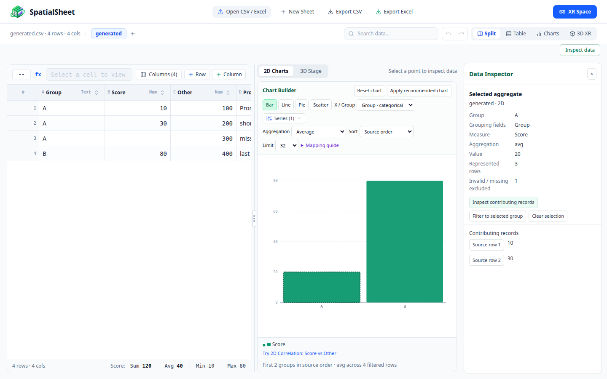
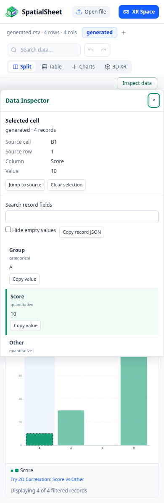

<div align="center">
  

# SpatialSheet

  **A local-first workspace for exploring structured data across spreadsheets, interactive charts, and 3D visualizations.**

  Import a dataset, understand its structure, inspect its quality, and move from individual records to aggregated visualizations—all in one browser-based workspace.

  [Features](#features) · [Getting started](#getting-started) · [Usage](#usage) · [Architecture](#architecture) · [Testing](#testing) · [Limitations](#current-limitations)
</div>

---

## Overview

SpatialSheet brings spreadsheet exploration and visual analytics together. Instead of switching between separate tools for tabular inspection, chart configuration, and spatial visualization, it provides linked views of the same underlying workbook.

The project emphasizes **transparent data transformations**, **source-record traceability**, and a **browser-based workflow**. Its current chart suggestions and data-quality observations are rule-based, not LLM-generated.

## Features

| Area | Capabilities |
| --- | --- |
| **Dataset Overview** | Sheet summary, semantic field types, searchable column catalog, column statistics, and dataset-quality observations. |
| **Data quality** | Missing values, potential type inconsistencies, repeated identifiers, and constant or near-constant columns, with explanations and links back to source cells. |
| **Spreadsheet** | CSV/Excel import, cell editing, multiple sheets, search, filtering, sorting, undo/redo, and a virtualized grid. |
| **Column management** | Resize, auto-fit, pin, hide/show, and reorder visible columns without changing source column order. |
| **2D charts** | Bar, line, pie, and scatter charts with field/series selection, supported aggregations, sorting, and display limits. |
| **3D workspace** | Interactive 3D bar, scatter, and ring representations with configurable mappings and analytical interactions. |
| **Unified Data Inspector** | Inspect selected cells, rows, chart points, spatial objects, and aggregates; view full text; copy values; and navigate to contributing records. |
| **Suggested analyses** | Deterministic, schema-aware suggestions that open supported 2D or 3D views. |
| **Flexible layout** | Overview, Table, Split, Charts, and 3D XR workspaces, with a resizable desktop split and responsive inspector. |
| **Export** | Export a sheet as CSV or a workbook as Excel. |

### Screenshots

The repository includes screenshots captured during the earlier Inspector/Chart Builder phase:



<details>
<summary>Mobile Inspector screenshot</summary>



</details>

> These images document Phase 2 UI behavior and may not show the latest Dataset Overview interface.

## Getting started

### Requirements

- **Node.js 24** (`.node-version`; the project declares `>=24 <26`)
- **Bun 1.4.5** (the dependency manager used by this repository)
- A modern desktop browser; WebGL support is needed for the 3D stage

### Install

```bash
git clone https://github.com/minhduc5a15/SpatialSheet.git
cd SpatialSheet
bun install --frozen-lockfile
```

> **Dependency note:** At the time this README was prepared, the latest Phase 3 commit had a `bun.lock` inconsistent with `package.json`, causing `bun install --frozen-lockfile` to fail in CI. Until the lockfile is regenerated and committed using Bun 1.4.5, use `bun install` locally. Do **not** remove frozen-lockfile validation from CI as a workaround.

### Start the development server

```bash
bun run dev
```

Open **<http://localhost:3000>**.

### Build for production

```bash
bun run build
bun run preview
```

The build output is written to `dist/`. The `preview` command serves the production build locally; it is not a deployment step.

## Usage

1. **Import a dataset.** Use **Open CSV / Excel** to select a supported file. The file picker currently accepts `.csv`, `.tsv`, `.txt`, `.xlsx`, `.xls`, `.ods`, and `.json` inputs; exact parsing support depends on the import implementation and the file's contents.
2. **Explore the Overview.** Inspect sheet dimensions, inferred column roles, missing values, potential data-quality issues, and suggested analyses.
3. **Work with the table.** Edit cells, search or sort records, and customize column visibility, positioning, or widths.
4. **Build a chart.** Open **Charts** or **Split**, select a chart type, choose fields and series, and configure available aggregation and sorting controls.
5. **Explore in 3D.** Open **3D XR** to work with supported spatial mappings and interact with rendered data objects.
6. **Inspect the source.** Open **Inspect data** to examine selected records and aggregated values, including source rows contributing to supported aggregates.
7. **Export results.** Export source workbook data to CSV or Excel as needed.

**Important data semantics:** hiding, pinning, or visually reordering columns does **not** change their order in the underlying workbook or in a CSV export. Structural edits, such as deleting a column, do change the source data and can be undone.

## Architecture

SpatialSheet is a client-side TypeScript application built with **Vite**, **Tailwind CSS**, **Lit**, **Three.js**, and **XRBlocks**. Its analytical behavior is organized around a central store, deterministic transformation modules, and view-specific UI components.

```text
src/
├── core/
│   ├── store.ts                  # Workbook, UI, and analytical state
│   ├── dataWorker.ts             # Worker-side data operations
│   ├── workerClient.ts           # Worker communication / fallback
│   ├── dataProfiler.ts          # Semantic column profiling
│   ├── dataQuality.ts           # Dataset overview and quality analysis
│   ├── chartData.ts             # 2D chart data extraction/aggregation
│   ├── chartValidation.ts       # Chart configuration validation
│   ├── chartRecommender.ts      # Rule-based chart recommendations
│   ├── analyticalSelection.ts   # Source-record and aggregate resolution
│   ├── columnView.ts            # Visual column mapping
│   ├── columnViewPersistence.ts # Browser-persisted layout preferences
│   ├── spatialTransform.ts      # Spatial data transformation
│   └── history.ts               # Workbook undo/redo history
├── ui/
│   ├── DatasetOverview.ts       # Dataset overview workspace
│   ├── SpreadsheetGrid.ts       # Virtualized spreadsheet
│   ├── InteractiveChart2D.ts    # 2D rendering and interaction
│   ├── ChartBuilder.ts          # Chart configuration UI
│   ├── DataInspector.ts         # Unified source-data inspector
│   ├── ColumnManager.ts        # Column layout controls
│   └── WorkspaceSplitter.ts    # Resizable split layout
├── xr/
│   └── SpatialDataStage.ts      # 3D spatial stage
├── index.ts                     # Application composition
└── types.ts                     # Shared domain types

e2e/                             # Playwright workflows and fixtures
.github/workflows/ci.yml         # GitHub Actions verification
```

The data engine uses Web Workers for selected operations, and the grid uses row/column virtualization. Dataset overview statistics, chart summaries, and source-record lookups are derived from application data rather than AI-generated answers.

### Privacy and persistence

- Spreadsheet analysis is designed to work locally in the browser; ordinary dataset exploration does not require a cloud AI account.
- Some layout preferences are saved in browser `localStorage`.
- **Workbook contents are not automatically restored after a page reload.** Export your work before leaving the page.
- Layout preference keys can contain metadata such as file/sheet names and column-schema information. Avoid assuming that all metadata is ephemeral.
- Local-first operation does not by itself constitute a security or privacy audit.

## Testing

The repository includes Node-based unit/integration tests, Playwright Chromium E2E tests, and optional benchmarks.

Install the Chromium browser used by Playwright:

```bash
bun run playwright install chromium
# Linux runners may also require:
bun run playwright install --with-deps chromium
```

Run verification:

```bash
bun run lint          # Application and E2E TypeScript checks
bun run test:unit     # Node unit/integration tests
bun run test:e2e      # Chromium browser workflows
bun run build         # Production build
bun run verify        # Run the full sequence
```

Optional benchmarks:

```bash
bun run bench              # Microbenchmarks and standard Store runs
bun run bench:heavy        # Includes a 100,000 × 100 Store scenario
bun run bench:browser      # Browser measurement suite
bun run bench:browser:heavy # Memory-intensive 100,000 × 100 browser run
```

See [TESTING.md](TESTING.md) for detailed methodology, fixtures, known coverage boundaries, and CI behavior.

GitHub Actions runs static/unit/build checks and browser tests on pushes and pull requests targeting `main`. **A configured workflow is not proof of a passing build**; inspect the [Actions page](https://github.com/minhduc5a15/SpatialSheet/actions) for the latest result.

## Current limitations

- **No integrated LLM copilot yet.** Profiling, quality observations, and suggested analyses are deterministic.
- **No automatic workbook persistence.** Refreshing the page does not restore imported data and edits.
- **Large datasets may have noticeable import latency and main-thread blocking.** Performance optimization is planned for a later development phase.
- **Full XR hardware support is not verified by headless browser tests.** Normal-browser 3D rendering and interaction have test coverage, but headset behavior depends on the runtime environment.
- **Browser coverage is primarily Chromium.** Other browser engines and device/driver combinations have not been comprehensively verified.
- **Quality observations are advisory.** They indicate properties worth inspecting; they do not automatically clean or correct imported data.

## Roadmap

The following are **planned directions**, not features already delivered:

- [ ] Command palette and keyboard-first analytical workflows
- [ ] Further accessibility and interaction polish
- [ ] Performance investigation and optimization for large imports
- [ ] Optional AI-assisted analysis with validated, inspectable actions
- [ ] Broader browser/device compatibility verification

## Contributing

The repository is currently maintained as an evolving project. If you have access to the repository, consider opening an issue to discuss proposed changes or bug reports before submitting a pull request.

For changes, please run `bun run verify` where the environment supports Chromium and include regression tests for any fixes to data semantics or cross-view selection.

## License

No license file was present in the repository when this README was drafted. **No open-source license is currently declared.** Add a `LICENSE` file before distributing the project under a specific license; do not assume permission to reuse the code simply because a repository is viewable.
